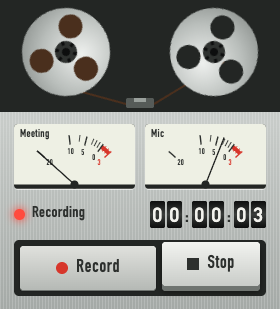

# Tab Recorder

Minimal Chrome extension (Manifest V3, no build step). Records the current tab's video, the tab audio (other people in a Meet call) and your mic into one local `.webm`. Nothing is uploaded.



## Install

1. `chrome://extensions` → turn on **Developer mode**.
2. **Load unpacked** → pick this folder.
3. Pin it from the puzzle-piece menu.

## Use

- Open the Meet tab → click the icon → **Start recording**. Or press **Alt+Shift+R** (change it at `chrome://extensions/shortcuts`).
- It always records the tab you clicked the icon on. If another tab is already recording, the popup says which one.
- The first time, a tab asks for the microphone. Choose **Allow while visiting the site**; it then starts recording the tab you clicked on, switches back to it and closes itself.
- Badge shows `REC` while recording. Press **Stop** or the shortcut again.
- The two needle meters show the meeting audio and your mic live: if the Mic needle doesn't move when you talk, your voice isn't being recorded.
- File: `~/Downloads/tab-recordings/YYYY-MM-DD_HHMMSS_<tab-title>.webm`.
- Closing the tab or leaving the page stops and saves automatically.
- Mic denied → it records tab audio only and the popup says so.

You keep hearing the meeting while recording. Use headphones, or the other people's voices are also picked up by your mic.

## Prepare a clip for AI

```sh
# Audio only, mono 16 kHz Opus: ~11 MB per hour, under Whisper's 25 MB limit
ffmpeg -i clip.webm -vn -ac 1 -ar 16000 -c:a libopus -b:a 24k clip.ogg

# Cut a part: from 12:30 for 5 minutes
ffmpeg -ss 12:30 -t 5:00 -i clip.webm -vn -ac 1 -ar 16000 -c:a libopus -b:a 24k part.ogg

# Transcribe with OpenAI
curl -s https://api.openai.com/v1/audio/transcriptions \
  -H "Authorization: Bearer $OPENAI_API_KEY" -F model=whisper-1 -F file=@part.ogg
```

## How it works

| File | Role |
|---|---|
| `popup.html/js` | Styled as a reel-to-reel field recorder: reels move tape as time passes, needle meters show live meeting and mic levels, tape counter, Record/Stop keys. Opens `mic.html` if the mic was never granted. |
| `background.js` | State (`chrome.storage.session`), badge, `tabCapture.getMediaStreamId`, download, shortcut. |
| `offscreen.html/js` | Gets the tab stream + mic, mixes the audio (Web Audio), records with `MediaRecorder`, plays the tab back to you. |
| `mic.html/js` | One-time mic prompt (popups and offscreen documents can't prompt). |
| `lib.js` | Pure helpers: file name, timer format, MIME type. |

Recording is held in memory until you stop (about 700 MB per hour at 1.5 Mbps video). WebM from `MediaRecorder` has no duration header: some players can't seek it, ffmpeg reads it fine.

## Tests

```sh
npm install
npx playwright install chromium   # once
npm test                          # unit tests (lib.js)
npm run test:e2e                  # records a fake meeting tab in Chromium, checks the file with ffprobe/ffmpeg
HEADED=1 npm run test:e2e         # same, with visible windows
npm run screenshots               # popup states → test/screenshots/ (the e2e also saves live-recording.png)
npm run icons                     # icons/icon.svg → icon-16/32/48/128.png
```

The e2e needs `ffmpeg`/`ffprobe` on PATH. It plays a quiet 440 Hz tone. It uses `--allowlisted-extension-id` because a test can't click the toolbar button, and seeds the mic grant in the profile because Playwright can't grant permissions to extension origins.
